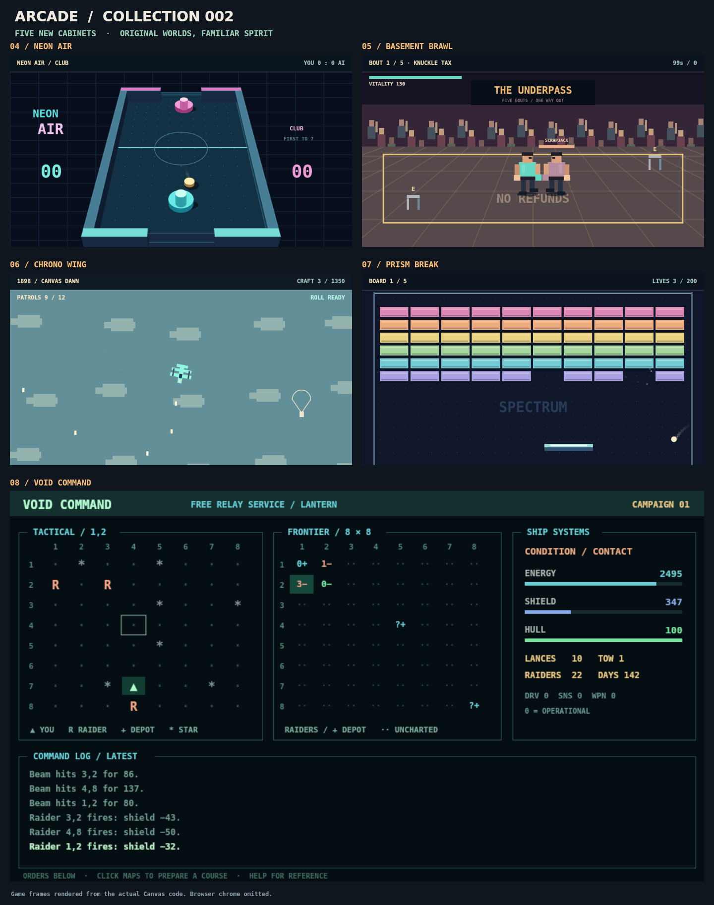
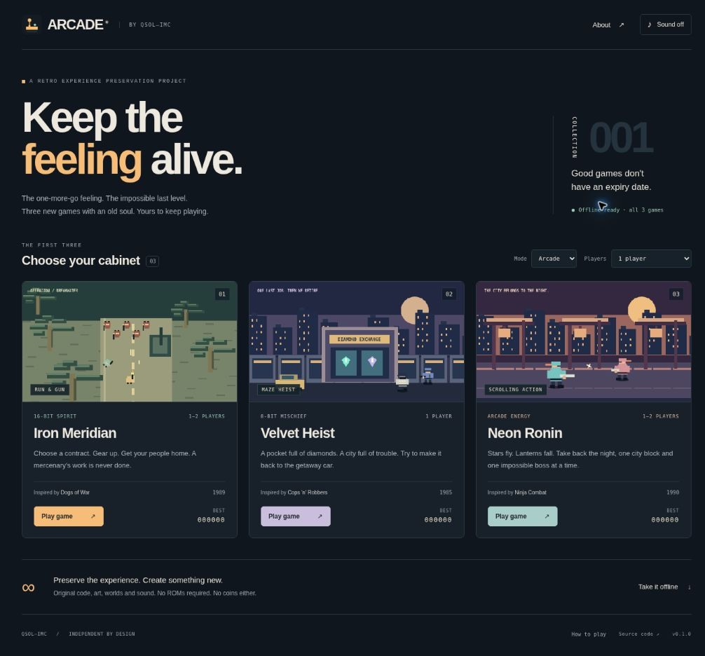
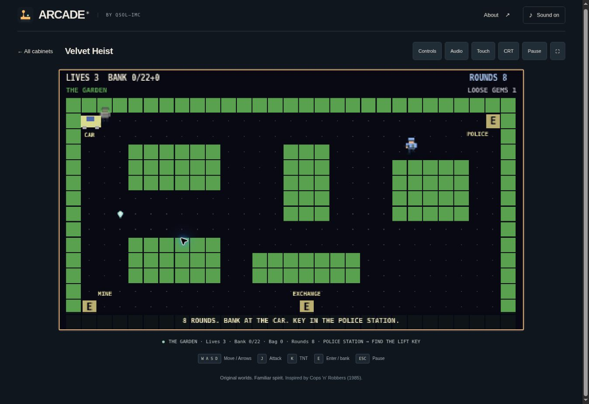

# ARCADE

**Keep the feeling alive.** Eight original retro browser games for the preservation of game experiences, from QSOL–IMC.

[**Play the arcade**](https://qsolkcb.github.io/ARCADE/) · [**Download for offline play**](https://github.com/QSOLKCB/ARCADE/archive/refs/heads/main.zip) · [Controls](docs/CONTROLS.md) · [Preservation notes](docs/PRESERVATION.md)

| Cabinet | Historical inspiration | This implementation |
| --- | --- | --- |
| **Iron Meridian** | *Dogs of War* (1989, Amiga / Atari ST) | Three mercenary contracts, team loadout shop, four weapons, limited ammunition with unlimited sidearm fallback, grenades, rescue/recovery objectives, armoured roadblocks and extraction. 1–2 players. |
| **Velvet Heist** | *Cops 'n' Robbers* (1985, Commodore 64) | Seven authored screens, pursuing police and reinforcements, limited shots, lifts, a key/code/safe puzzle, TNT, a torch-lit gallery, helicopter warnings, 22 gems, banking and jail rescues. 1 player. |
| **Neon Ronin** | *Ninja Combat* (1990, arcade / Neo Geo) | Three city districts, twelve encounter blocks, three bosses, throwing stars, close-range attacks, jumps, rechargeable storm attacks, weapon/health pickups and local co-op revives. 1–2 players. |
| **Neon Air** | Air hockey | Perspective 3D table, velocity-based mallet strikes, bank shots, first-to-seven matches and Rookie / Club / Expert AI. 1 player. |
| **Basement Brawl** | *Pit-Fighter* (1990) | Three fighters, five arena bouts, depth movement, punches, kicks, jump attacks, guard, combos, chairs and stagger throws. 1 player. |
| **Chrono Wing** | *Time Pilot* (1982) | Free flight through five eras, patrol quotas, flagship bosses, courier rescues, evasive rolls and replacement craft. 1 player. |
| **Prism Break** | *Breakout* (1976) | Five brick boards, paddle-angle control, armoured bricks, multiball, wide paddle, slow ball and laser capsules. 1 player. |
| **Void Command** | *Star Trek* (1971), gameplay only | An original terminal command deck: 8 × 8 frontier and tactical grids, three seeded campaigns, scanning, navigation, combat, shield transfers, damage/repair, docking and deadlines. 1 player. |

These are new interpretations of the play experiences, **not exact ports or emulations**. Code, maps, characters, pixel art, sound effects and musical sequences are original to this project. No ROMs, original game assets or recorded soundtrack samples are required or included.

## Collection 002 — v0.3.0

Five new cabinets expand the collection to eight. **Void Command** uses a browser-native, ncurses-inspired command deck with bordered panels, tactical and frontier maps, resource gauges, a command log, clickable orders and command history. Its ship, factions, terminology, setting and art are original.

**Neon Air** uses a software-projected 3D table and shaded geometry, rendered through Canvas 2D. Rookie, Club and Expert opponents have distinct reaction delays, movement limits, aiming error and prediction; choose one on its cabinet card. This AI setting controls the hockey challenge independently of the collection's Arcade/Relaxed setting.



These are game-code renders for documentation, not browser screenshots. See [verification](docs/VERIFICATION.md) for browser coverage and its limits.

### Original collection



## Second pass — v0.2.0

Velvet Heist now concentrates on the C64 adventure loop: spend ammunition to escape a pursuit, gather tools, open the safe, brave the dark mine and decide when to bank your bag. Its graphics stay deliberately simple. Iron Meridian and Neon Ronin retain their combat rules, with animated hits, richer particles, projectile trails, environmental detail and distinct original music.



## Play offline

1. Download the repository ZIP and extract it.
2. Open `index.html` in a modern browser. Keep `js/`, `assets/` and the other runtime files beside it.
3. Pick a cabinet and play. No installation, package manager, server or network connection is required.

The hosted HTTPS version also caches all eight games. Wait for **Offline ready · all 8 games** before disconnecting, then revisit the same address. Browser data clearing removes this cache. A new cached release waits for you to select **Update ready · Reload** from the launcher.

Scores and settings are local to the browser/device; current runs are not saved. If storage is blocked, the games still run. Sound starts disabled and can be enabled in the header. Each cabinet has an **Audio** panel with separate music and effects levels; set music to zero for effects only. There are no accounts, trackers, ads or external runtime dependencies.

## Controls

| Action | Player 1 | Player 2 |
| --- | --- | --- |
| Move | WASD; arrows also work in solo mode | Arrow keys |
| Attack | J / Z | U / Numpad 1 |
| Grenade, TNT or storm | K / X | I / Numpad 2 |
| Dash / jump | Space / C | O / Numpad 0 |
| Use, switch weapon or hold to revive | E | H / Numpad 3 |
| Pause | Escape / P | Escape / P |

Iron Meridian also supports mouse aim, left-button fire and right-button grenades. Standard gamepads: left stick/D-pad, A attack, B special, X jump/dash, Y use, Start pause. Touch controls are available through the **Touch** button. Local co-op uses a shared screen; Velvet Heist and the five new cabinets are single-player. Select **Relaxed** for more forgiving health, lives and enemy behaviour. High scores are separated by difficulty; Neon Air also separates Rookie, Club and Expert scores. The rebuilt Velvet Heist uses a new score table; first-edition scores remain stored without being mixed into the new rules.

### New cabinet controls

| Cabinet | Controls |
| --- | --- |
| Neon Air | Mouse / touch drag or WASD / arrows moves the mallet; J / controller A strikes. |
| Basement Brawl | Move, J punch, K kick, Space jump, E pick up / throw; hold E to guard. |
| Chrono Wing | WASD / arrows steer; hold J to fire; K for a rechargeable evasive roll. |
| Prism Break | Mouse / touch drag or left/right moves; J / Space launches; J fires active lasers. |
| Void Command | Type `HELP`; enter commands or click quick orders. Click maps to prepare `MOVE`, `LANCE` or `JUMP`, then Execute. ↑ / ↓ command history. |

Void Command uses the keyboard or touch console rather than the action-game controller buttons. Coordinates are column then row, from 1 to 8. Commands are queued into the fixed-step loop; time advances only for accepted operational orders. `HELP`, `MAP`, `STATUS` and invalid orders are free. The terminal canvas scrolls horizontally on narrow screens to preserve legible text.

## Hosting and development

Serve the repository root with any static host. The included **Publish arcade** workflow verifies the games and deploys only their runtime files to the already-enabled GitHub Pages site on pushes to `main`. It uses pinned official GitHub actions and requires no package installation or application build. A branch-based host can also serve `main` at `/ (root)`.

The runtime uses HTML, CSS, classic JavaScript, Canvas 2D and Web Audio. It intentionally does not require WebGL, a game engine, a CDN or npm dependencies. All paths are relative so the same files work under `/ARCADE/`, another subdirectory, or directly from disk.

Optional local HTTP preview:

```sh
python3 -m http.server 8080
```

Development checks use Node.js 20 or later, with no dependency installation:

```sh
npm test
npm run check
```

See [verification](docs/VERIFICATION.md), [architecture](docs/ARCHITECTURE.md), [invariants](docs/INVARIANTS.md), [asset provenance](docs/ASSETS_AND_RIGHTS.md) and [contributor rules](AGENTS.md). When changing a runtime file, update the cache revision in `sw.js`.

## Licence

The original project contributions use the repository's [Apache License 2.0](LICENSE). Historical game names identify inspirations and remain associated with their respective creators and rights holders. ARCADE is an independent project, without affiliation or endorsement.
