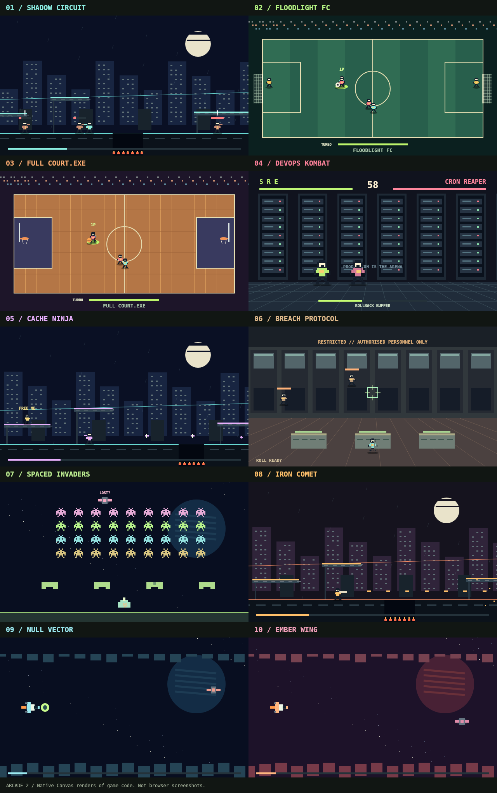

# ARCADE 2 verification record

## v0.6.0 graphics pass — 8 November 2026

Base: QSOLKCB/ARCADE `2a7d112` (main, after PR #7). Sources read: QSOLKCB/VANILLAJS
`main` `9e643c7` (no module changes since the v1.2.0 pin `c8d6e99`) and QSOLKCB/OPT
`main` `7556dd3` (catalogue v1.4.0). Environment: Node v22.23.4; the session's
preinstalled Playwright Chromium, headless, software rasterisation.

### Simulation unchanged

Before any presentation change, `tests/arcade2-parity.test.cjs` recorded SHA-256
hashes of the complete game state for all ten cabinets: one 5,400-tick scripted
session each, and one complete policy-driven campaign each (all stages, bosses and
transitions). After the work all 20 hashes still match. Each is also replayed with
`draw()` and the post pass running between ticks, with identical results.

### Executed

| Check | Observed result |
| --- | --- |
| `npm test` | **237 passed, 0 failed**: 20 new parity pins, 9 graphics/sound checks, one new offline deep-link check; the previous 207 unchanged. |
| `npm run check`, `node scripts/arcade2-engine.cjs --check` | Passed; the adapter matches four pinned modules (`integer-math`, `time`, `frame-gate`, `audio2d`). |
| Cache-key completeness (OPT-INC-001) | Caches cleared before sampled frames of every campaign in both tiers; every re-painted key produced an identical draw log. |
| Draw-call budget (OPT-BUDGET-001) | Peak calls/frame across campaigns: full 107–866, lite 63–231 (limits 1,000 / 300). Means fell from 200–815 (v0.5.0) to 98–338 (full). |
| Chromium paint time per frame, draw + post + 1-px readback | v0.5.0 median 0.2–0.4 ms, p99 0.4–1.0 ms. v0.6.0 full: median 0.3–0.8 ms, p99 0.8–1.8 ms. Lite: median 0.2–0.6 ms, p99 0.3–1.3 ms. Isolated maxima of 4–10 ms occur when a stage's layers are first built. |
| Real tick rate in the running app | Counted `tick()` calls over 5 s of wall time: Shadow Circuit, DevOps Kombat, Breach Protocol, Spaced Invaders and Ember Wing 60.00/s; Floodlight FC 60.19/s (window boundary). rAF interval while playing: median 16.70 ms, max 16.80 ms. |
| Hall and all ten cabinets over HTTP | Ten previews rendered; each cabinet launched from its Play button, ran 2.5 s with held keys, paused and resumed with P, and returned to the hall. Sound on, FX toggled full → lite → full. No page or console errors. |
| `file://` | Hall and Spaced Invaders played through the UI from the checkout; no errors. |
| Offline | The worker installed `v0.6.0-r1-arcade2` with `gfx.js` and `sound.js`. With the local server shut down, reloading `arcade2/index.html#ember` loaded from cache and the cabinet ran. This **failed before the fix** (`ERR_CONNECTION_REFUSED`) because Chromium includes the `#fragment` in navigation request URLs. |
| Phone layout (Playwright iPhone 13 profile) | Hall and playroom have no horizontal overflow at 390 px; the FX button fits the masthead. |

### Not established

Real GPUs and displays, Firefox and Safari, physical touch and controllers, and
audible output. Headless Chromium created and played the audio2d buffers without
errors, but nobody listened. Paint times are from one software-rendered
environment, not device benchmarks. The automatic lite fallback was triggered by
artificially adding 9 ms to Null Vector's full-tier draw in the page (label became
*FX lite (auto)*, nothing was saved, the button restored full), not by a slow device.

Implementation base: QSOLKCB/ARCADE
`2296034a04c5417c4a8f6057c2dd73b06adccb8e` (main).
Engine source: QSOLKCB/VANILLAJS v1.2.0
`c8d6e9972d2214e2f5330f80f7dee49750c2e776`.
The release ref was read from GitHub and matches the supplied ZIP's commit comment.

## Executed

| Check | Observed result |
| --- | --- |
| `npm test` (Node v24.22.1, built-in test runner) | **207 passed, 0 failed, 0 skipped**: 143 original-hall checks and 64 ARCADE 2 checks. No packages installed. |
| `npm run check` | Passed JavaScript syntax, local assets, classic scripts, relative URLs, cache coverage and no external runtime-request checks. |
| `node scripts/arcade2-engine.cjs --check` | Generated adapter matches the preserved v1.2.0 module bytes and pinned SHA-256 values. |
| `git diff --check` | Passed. |
| Existing replay pins | All 15 original game/difficulty replay pins pass unchanged. |
| New seeded simulations | Two identical scripted input streams produce equal full game states for each cabinet; drawing does not mutate those states. Effects, events and projectile pools stay bounded. |
| New complete campaigns | All ten fresh cabinets reach victory using state-aware control packets and normal stage transitions only. No health grants, timer edits, teleportation or target deletion. |
| Failure and mechanic scenarios | Goal-mouth crossing; basketball rebounds, dunks and buzzer flight; block/rollback/KO precedence; pits, ledge reachability and rescue gates; cover damage; pod/charge/burst behavior; changing scroll axes; shields, invasion landing and limited craft. |
| Input event harness | Keyboard aliases, quick taps, default prevention on repeated gameplay keys, auto-repeat after clearing, touch cancellation/lost capture, controller neutral arming, disconnect pause, menu edges and pointer/keyboard ownership pass. This is a mock event environment. |
| Navigation URL/filesystem checks | Both halls' local links resolve to regular files under `file://` and a nested HTTP base URL. This checks URL resolution and file existence, not browser execution. |
| Service-worker harness | All **34** precached URLs resolve without network in the cache mock, including nested `arcade2/` navigation. Scope isolation, failed installation and explicit update activation pass. |
| Native Canvas rendering (initial implementation) | All ten game renderers executed through the preinstalled `@napi-rs/canvas`; the contact sheet below was visually inspected. This package is not added to the repository or runtime. |

The control-only completion policies live in `tests/arcade2-playthrough.test.cjs`.
They can inspect exact state when choosing actions and are not evidence of human
skill requirements, controller usability or difficulty balance. Boundary scenario
tests deliberately arrange state near an event; these are separately identified in
the test names and do not underpin the control-only completion claim.

Longer completion probes exposed a soccer boundary that bounced shots before the
goal line and an overly wide high-platform gap. Both were fixed and now have
specific regression checks. The checked arithmetic also caught a fractional
half-width passed as an integer; it now uses `fromRatio(numerator, 2)`.

## PR #7 review corrections

Regression tests were first executed against the reviewed head
`dd7c6d93f3c1453a029bc4bce0f0a9bdccd4b900` and reproduced all four findings.
The full suite above passed after the corrections:

- Soccer targets sit beyond both scoring planes. Both teams shoot toward their
  opponent's goal across sampled legal possession bounds, and all three vertical
  aim choices score from the corresponding goal-line boundary.
- The root hall link and both ARCADE 2 home links name `index.html` explicitly.
  The URL/filesystem regressions cover file-open and nested-hosting paths.
- Initial and repeated ArrowDown/Space events prevent browser defaults during
  play, without generating repeat action edges or re-arming cleared controls.
  Inactive play, editable fields, shortcuts and unbound keys retain defaults.
- Breach reclaims defeated enemy slots before spawning and advances its wave
  quota only after a successful spawn. Full-pool grenade tests retain the second
  and third compounds' 220/260-HP bosses; normal firing must defeat each boss
  before stage completion. A separate capacity test covers rejected reinforcements.
- The runtime cache key advances to `v0.5.0-r3-arcade2`.

## Browser and device coverage

A local Playwright/Chromium launch was attempted. Chromium aborted before loading
the game with `socket() failed: Operation not permitted` in its process-singleton
setup. The shared browser could not reach the local preview server and subsequent
observation was rejected by its URL policy. No browser access restrictions were
changed or bypassed.

Consequently, this execution does **not** establish browser DOM/CSS rendering,
actual file-open execution, real service-worker offline reload, audible output,
physical touch/controller behavior, mobile layout or device performance. The
implementation includes these paths; their browser/device coverage remains open.
No browser/device check was rerun for these review corrections. No release or
merge is performed by this correction task.

## Cabinet renders

These are native Canvas renders of the game code after roughly 150 simulation
ticks, composed into a contact sheet. They are not browser screenshots. No
commercial game imagery is used.

