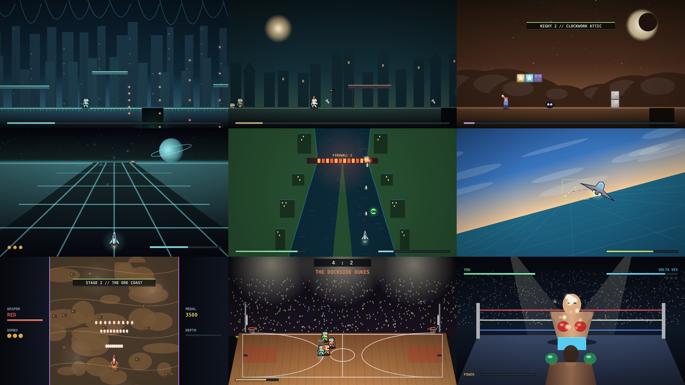

# ARCADE 3 verification record

## v0.8.0 — 9 November 2026

Environment: Node v22.23.4, and the session's preinstalled Playwright Chromium
(headless, software rasterisation). Base: `main` `eb46499` (v0.7.0).

| Check | Observed result |
| --- | --- |
| `npm test` | **362 passed, 0 failed**. 39 of these are in `tests/arcade3.test.cjs`; every ARCADE 2 and original-hall pin is unchanged. |
| `npm run check` | Passed. This includes the new ARCADE 3 block: local relative URLs, every cabinet script loaded by the hall, and the service worker precaching `./arcade3/`. |
| Completion | The control-only policies win all nine campaigns (29 stages). In ticks to win: Commando 6,427; Lantern 3,915; Sleepwalker 4,684; Lancer 7,148; Canal 12,288; Skyline 5,201; Stratos 13,545; Feud 16,842; Knockout 6,636. |
| Policies do real work | A fixed naive input pattern loses every campaign except Hard Court Feud, where the AI teammate can carry a game; it still loses a credit there. |
| Campaign pins | Nine SHA-256 state hashes. Each campaign is also replayed with `draw()` and the post pass between ticks, giving identical hashes. |
| Draw-call budgets | Full-tier peak 764 (Stratos Ward), lite-tier peak 290, against the ARCADE 2 limits of 1,000 / 350. Caches stay within their pixel budgets. |
| Fairness | Tested directly: Sleepwalker has no blocks over a pit's jump arc and no walls on landings; moth-owls patrol clear of pits and tall towers; every Canal Cutter channel in all three runs is at least 60 px wide. |
| Chromium, `file://` | The hall shows 9 cards; the Sports filter shows 2; the featured preview is Knockout Circuit. Each cabinet launches from its card with the Mode menu hidden, a live HUD and objective, a `#id:extended` hash and `qsol-arcade3:` storage keys. Loading `#feud:extended` fresh opens Hard Court Feud. Cross-links work between all three halls. No page or console errors. |

### Bugs found and fixed while proving completion

- **Commando:** turrets and the boss's low gun could not be hit by standing fire.
  Hitboxes are now centred on each body. The cull no longer removes placed foes
  (including the boss) on the first tick. Runners no longer spawn behind the boss
  wall. Pits needed frame-perfect jumps and were narrowed to 50–60 px.
- **Lantern:** spawn positions could be fractional, which the checked Q16.16 math
  rejects. Wraiths hovered out of reach. Up to six risers could crowd the player;
  the cap is now four.
- **Sleepwalker:**
  - ceiling blocks could bonk a jump before or over a pit
  - moth-owls hovered over pits and over a three-high pillow tower, which stalled
    the night-2 policy
  - the respawn position could be fractional
- **Canal Cutter:**
  - a fork could begin right at a bridge restart point, so a respawn in mid-channel
    hit the island tip; the section after each bridge now never forks
  - shots could fly past the top of the screen and destroy buoys as they appeared;
    shots now expire at the screen edge, and every fork has a buoy in each channel
- **Hard Court Feud:** the first balance let a defender strip every possession.
  Ball carriers can now ride out an elbow (always just after an inbound), a whiffed
  elbow is slow to recover, and rival enforcers go after your defender.

### Not verified

There is no RTX run for ARCADE 3; the self-hosted workflow measures ARCADE 2 only.
I did not play the cabinets by hand. Feel and difficulty for a human player are
judged only from the policies and the naive-input baseline.
