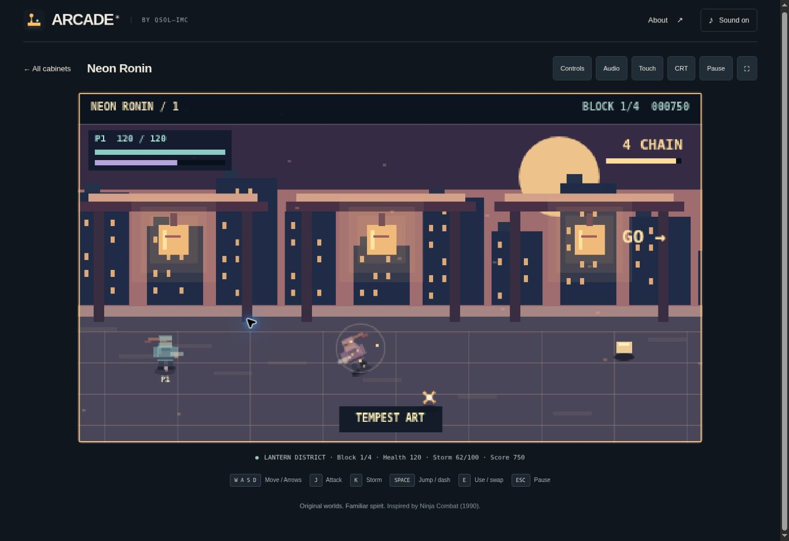

# Verification

## Collection 002 — v0.3.0, 30 October 2026

### Automated checks

`npm test`: **102 passed, 0 failed**. `npm run check`: passed (syntax, relative asset URLs, complete precache coverage, file-open-compatible classic scripts and no external runtime game-data dependencies). `git diff --check`: clean. No npm packages were installed or added.

The suite retains the original three games' real-damage replays and adds:

- Hockey projection/unprojection, AI speed and reaction distinctions, rail rebounds, mallet momentum, goal-slot scoring and first-to-seven victory/defeat.
- Brawl fighter stats, finite chairs, frontal guard, jump avoidance, throws, poise, failure and five-bout transitions. Complete normal-input replays with all three fighters on both difficulty settings, without changing health/damage or forcing stage completion.
- Chrono firing, rescues, rolls, finite lives, patrol quotas and all five flagship transitions. A complete normal-input Relaxed replay. Fatal-damage regressions prevent a flagship transition or rescue bonus from reviving a lost run. A complete Arcade input-replay victory is **not** claimed.
- Breaker launch, edge aiming, reinforced bricks, capsule duration, multiball cap, ball loss/restart and five boards. Complete paddle-input replays on both difficulty settings with actual ball/brick collisions.
- Void command rejection without costs; free reads; idle turns; bounded command queue; shield transfer; obstacle movement; lance blocking; split beam damage; retaliation; docking; repairs; one-use tow; deadline/hull loss; victory; fresh choices and layouts. Complete command-only playthroughs of all three campaign seeds on both difficulties, using scanned chart information and visible local cells.
- Finite drawing coordinates and bounded simulation/presentation pools for all new games. Audio scheduling for all eight original arrangements. Direct paddle touch cancellation and keyboard takeover from a mouse target. All 18 precached runtime entries served by the service-worker harness with networking disabled.

### Visual and browser checks

The managed preview launched. Its eight-cabinet launcher was inspected through the browser UI. Void Command's start, `SCAN`, typed `JUMP 2 2`, resource/status updates and full HELP panel were exercised and visually inspected. Neon Air's 3D table, active match, keyboard input and pause menu were visually inspected.

During refresh, the browser policy gate subsequently rejected access with an unsupported-protocol error. Further browser interaction stopped. The final terminal-focus/restart refinements and the other three new cabinets were therefore **not** re-verified in a browser. There is no claim of a full final-build browser pass, real-device gamepad/mobile testing, downloaded `file://` play, audible-output testing or real-browser offline reload for this revision. The HTTP preview did not provide a secure service-worker context; offline behaviour was tested in the existing worker harness and statically checked.

All five new game renderers were also run through an installed offline Canvas implementation and the resulting frames visually inspected. `collection-002-v030.png` and `void-command-v030.png` are clearly labelled game-code renders, **not browser screenshots**. That renderer and its system-font registration were temporary QA tools; the game and test suite have no new dependency.

### Deployment

This revision is prepared as a pull request. The existing workflow verifies and publishes runtime files on merge to `main`; it has not been replaced or expanded. The v0.3.0 cache key includes all five new scripts. Existing players should use **Update ready · Reload** after the release is deployed. This log does not claim that an unmerged branch is live on GitHub Pages.

---

## Second pass — v0.2.0

`npm test` passes **54 tests**; `npm run check` and `git diff --check` pass. Six normal-input replays complete all three games on both Arcade and Relaxed, with real damage and resource limits. The heist replay collects equipment, uses lifts, opens the safe and giant-ghost gate, enters the dark gallery, recovers any lost gems, frees captured lives and banks all 22 gems. It never grants lives, moves actors directly, removes enemies or forces progression.

New regression coverage checks the seven authored maps and all fixtures, permanent key/code requirements, interrupted safe cracking, non-wasteable TNT, torch expiry/recharging and an unlocked return route, shooting police and small ghosts, bounded/announced reinforcements, helicopter warning time, recoverable bags and captured lives. Audio checks cover optional context creation, finite musical notes, voice cleanup/limits, saved-level validation and independent music/effects muting.

A separate before/after comparison ran the existing combat input replays against the first-release commit `5ba9d07747f9b11a4553f2f46d489fccfe5a1953` and the second-pass files. Iron Meridian and Neon Ronin matched tick for tick on both difficulties for player positions, health, ammunition/energy, enemy positions/health, projectile counts, scores and progression. The presentation pass therefore preserved those recorded gameplay outcomes exactly.

Chromium preview checks exercised all three cabinets, the updated heist briefing and shooting, action-game attacks, grenades, two-player ninja controls, jump/storm, pause, and the Audio panel. Music/effects values were changed, survived reload, and displayed correctly in a 390-pixel iframe. The heist touch controls show TNT and Enter/bank and hide the unused jump button. The narrow page and audio panel had 390-pixel content/scroll widths, with no horizontal overflow. Page-specific console inspection found no application errors. These are UI/rendering observations, not a claim of physical-controller or hardware-audio verification.

Published runtime commit: `55dc819a0f543931ca9f1a0b271d571da3a8d432`. The [Pages run](https://github.com/QSOLKCB/ARCADE/actions/runs/40491180071) passed verification and deployment. On the live HTTPS site, the existing v0.1.0 cache displayed the update button; selecting it loaded v0.2.0, removed the prompt and retained “Offline ready · all 3 games”. All three cabinets launched from that updated collection. Page-specific live console inspection found no application errors.

## First release — v0.1.0

## Automated checks

Run `npm test` and `npm run check` with Node.js 20 or later. No dependency installation is needed.

The initial suite passes **44 tests**. The suite covers:

- Fixed-step timing, bounded catch-up, repeatable random sequences, particle limits and unavailable/corrupt storage.
- Affordable team loadouts, ammunition fallback, walls stopping actors and projectiles, objective/extraction requirements, revives, all three contract transitions, and fresh-run state.
- Connected heist fixtures and loot, wall-safe police routes, bidirectional room transitions, safe-code requirements, banking all 22 gems, recoverable dropped loot, jail lives and failure/reset.
- Ninja melee versus ranged attacks, jump invulnerability/landing, special energy cost, wave gates, twelve blocks, three boss transitions, co-op revives and final outcomes.
- Defeat taking precedence over completion when the last player takes fatal damage in the same tick as extraction or boss clearance.
- Very short keyboard taps, separate repeated presses, cleared input, modal Escape handling, gamepad Start polling while paused, player-key separation and pointer cancellation.
- Complete offline cache coverage with a mocked unavailable network, exact-scope cache cleanup, explicit update activation and failed-install handling.
- Four complete input-driven combat replays: Iron Meridian and Neon Ronin, each on Arcade and Relaxed. These use normal damage, normal resource limits and ordinary game inputs; they do not remove enemies, grant invulnerability or force transitions.
- Finite drawing coordinates across all stages and rooms; syntax, local dependency paths, cache coverage and absence of remote game-data calls.

## Browser observations

Chromium cloud preview was used to inspect the launcher, artwork, game briefings, weapon purchases, all three rendered games, keyboard actions, health/resource/score displays, help, pause and restart controls. A 390-pixel iframe was used for narrow-layout and touch-control inspection. The action games expose separate player-two controls and HUDs. Page-specific console checks found no application errors during these checks.

The development preview is plain HTTP on a non-localhost hostname, so it correctly offers a download instead of claiming an offline cache. The published HTTPS launcher at https://qsolkcb.github.io/ARCADE/ loaded successfully, reported “Offline ready · all 3 games”, and launched Neon Ronin without application console errors. The initial publishing run passed all 44 tests and deployment: https://github.com/QSOLKCB/ARCADE/actions/runs/40486083566.

## Limits

This is a first playable release, not a certified compatibility matrix or a claim of exact equivalence to the historical games. The scripted campaign replays establish that the combat campaigns are completable; human difficulty tuning and extended playtesting remain useful.

The cloud browser disallows file:// navigation, so direct file-open execution could not be browser-tested here. Static checks confirm classic scripts, local asset paths, no fetched game data and a service-worker-independent runtime. Real gamepad hardware, real touchscreen devices, Firefox and Safari were not available for this pass; input mappings and cancellation were tested with controlled inputs. The offline network-failure tests run against the service-worker logic, rather than disconnecting a physical device.

The Pages publishing workflow runs the same checks before staging the static runtime, with official actions pinned to verified commit SHAs and an Ubuntu 24.04 runner.

Final runtime publication also passed: https://github.com/QSOLKCB/ARCADE/actions/runs/40486526192. The live update prompt was exercised: selecting Reload activated the new cache, refreshed the launcher, removed the update prompt and retained the offline-ready status.
